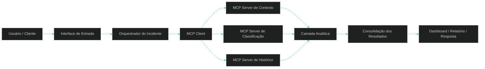
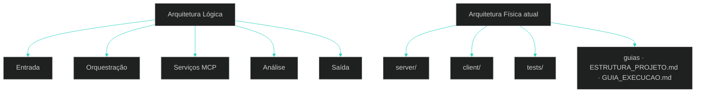
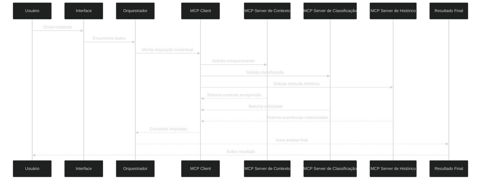
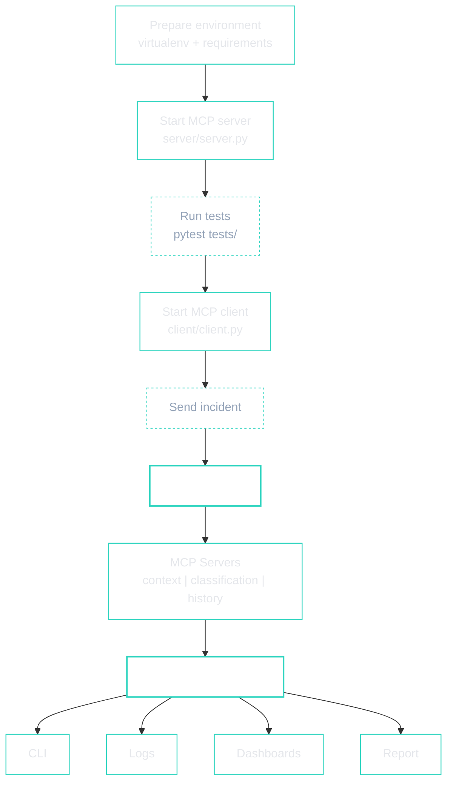

**\[[🇧🇷 Português](README.pt_BR.md)\] \[**[🇺🇸 English](README.md)**\]**

<br><br>


#  <p align="center"> 🕸️  [Project 3 - Distributed Systems]() - [MCP Smart Incident Analyzer]() · [Distributed AI incident Analysis for Governance, Responsible AI and Ethics]() </p>

### <p align="center"> Distributed Communication for AI with MCP (Model Context Protocol) </p>

<br><br>

#

<br><br>

<!-- ========= END REPO TITLE ========= -->

<!-- ========= Start SPONSOR BADGE ========= -->
<p align="center">

  <a href="https://github.com/sponsors/Mindful-AI-Research">
    
</p>
<!-- ========= END SPONSOR BADGE ========= -->


 <!-- ========= START TEASER ========= -->
<p align="center">🦾 <em>Connecting systems, intelligence, security, and humans — one distributed headache at a time</em> 🪽</p>

<p align="center"><em>If it scales, it breaks. If it breaks, it becomes a feature.</em></p>

### <p align="center">⚡️</p>

<br><br>
<!-- ========= END TEASER ========= -->

<!-- ========= Start Overview ========= -->
## [Overview]()

This project is designed as a governance and Responsible AI layer, focused on the structured monitoring, analysis and documentation of AI incidents to support transparency, accountability and ethical decision-making in socio-technical systems.

<br><br>
<!-- ========= END Overview ========= -->


<!-- ========= START MAIN BADGE ========= -->
<p align="center" style="margin: 0;">
  <a href="https://melodious-squirrel-7f92a7.netlify.app/" rel="noopener noreferrer">
    
  </a>
</p>

<!-- ========= START SECONDARY BADGES ========= -->
<p align="center" style="margin: 0;">
  <a href="https://docs.google.com/presentation/d/1lbAfse10pa_k560jxd0nQEE_ISdIEweC/edit?slide=id.p1#slide=id.p1" rel="noopener noreferrer">
    
  </a><a href="https://github.com/Mindful-AI-Assistants/3-distributed-system-mcp-smart-incident-analyzer/blob/1d44712671b1f90607539b588c1fe74d4630a3df/DATA_ANALYSING_REPORT/%F0%9F%87%AC%F0%9F%87%A7English/%F0%9F%87%AC%F0%9F%87%A7Data%20Analysing%20Report%20-%20MCP%20Incidents.pdf" target="_blank" rel="noopener noreferrer">
    
  </a>
</p>


<br><br><br><br>
<!-- ========= END MAIUN BADGE ========= -->


<!-- ======================================= Start nstitucional INFO ===========================================  -->
 <!--### <p align="center">    -->

[**Institution:**]() Pontifical Catholic University of São Paulo (PUC-SP  Humanistic AI & Data Science • 5º Semestre ) 2026 <br>
[**School:**]() Faculty of Interdisciplinary Studies  <br>
[Course Repo:]() INTEGRATED PROJECT: MACHINE LEARNING  <br>
**Prof. Dr.:**  [⭐️ Carlos Eduardo Paes](https://www.linkedin.com/in/carlos-eduardo-de-barros-paes-ph-d-7b137a4/) (Cacá)  <br>
**Author:**  [Fabiana ⚡️ Campanari](https://linktr.ee/fabianacampanari)  


<br><br>

#

<br><br>
<!-- ========= END Institucional INFO ========= -->


<!-- =========  START DEMO VIDEO ========= -->
https://github.com/user-attachments/assets/b6c59c99-00a4-4545-b0ed-c8b262cd4709

###### 🎶 Habanera -- Remix
###### **Source:** Aria from the opera *Carmen*
###### **Significance:** Among the most iconic and enduring pieces in operatic history

> 🎶 *“L’amour est un oiseau rebelle que nul ne peut apprivoiser.”*

#

<p align="right">
<sub><em>curated edit · Fab⚡️</em></sub>
</p>

<br><br>


<!-- ========= START NOTE ========= -->
> [!NOTE]
>
> ⚠️ Projects may be publicly shared when permitted.  
> The focus is on applied, hands-on learning with real datasets in AI governance and security contexts.  
> All sensitive content remains protected in private repositories when required.
>

<br><br>
<!-- ========= END NOTE ========= -->

<!-- ========= START OVERVIEW ========= -->
## [Overview]()

The [**MCP Smart Incident Analyzer**]() is a distributed architecture project focused on the intelligent analysis of incidents related to **AI (Artificial Intelligence)** systems. The core of the proposal is the use of [**MCP (Model Context Protocol)**]() as the foundation for structured communication among components, agents, and specialized services.

In practice, the system was designed to receive events, occurrences, failures, deviations, or unexpected behaviors in AI-based environments, organize this material as analytical context, and route it to specialized interpretation modules. The goal is to transform complex incidents into traceable, explainable, documentable, and auditable cases.


<br><br>

#

<br><br>
<!-- ========= END Overview ========= -->


<!-- ========= START Main Repo REFERENCE  ========= -->
> [!TIP]
>
> ## 🕸️ Distributed Systems — Integrated Project Consulting Hub
>
> This repository is part of a broader academic and technical ecosystem focused on Distributed Systems, Scalable Architectures, Artificial Intelligence, and Human-Centered Technology.
>
> The project explores distributed communication, interoperability, scalability, and modern computational infrastructures applied to intelligent systems and academic research.
>
> Explore the central hub containing complementary materials, technical documentation, analyses, and related projects:
>
> 🔗 **[Access the Distributed Systems Hub](https://github.com/Quantum-Software-Development/1-Distributed-Systems-Operating-Systems-Hub)**
>
> #
>
> ### 🦾 AI Resources
>
> High-signal resources for learning, building, and understanding modern AI systems.
>
> **📘 Core Reading**
>
> - [**Artificial Intelligence: A Modern Approach** *(Peter Norvig & Stuart Russell)*](https://github.com/Mindful-AI-Assistants/3-distributed-system-mcp-smart-incident-analyzer/blob/90f1da40fa7a5a4887c49b9471f15744c7d132a4/Intelige%CC%82ncia%20Artificia%20A%20Modern%20Approachl%20(Peter%20Norvig%2C%20Stuart%20Russell)%20.pdf)
>


<br><br><br><br>
<!-- ========= END Main Repo REFERENCE  ========= -->
<!-- ======================================= END DEFAULT HEADER ⚡️ ===========================================  -->


## Table of Contents

- [1.Problem Context](#1-problem-context)
- [2. Project Objective](#2-project-objective)
- [3. Proposed Solution](#3-proposed-solution)
- [4. Why Use MCP](#4-why-use-mcp)
- [5. Core Concepts and Acronyms](#5-core-concepts-and-acronyms)
- [6. Solution Architecture](#6-solution-architecture)
- [7. Logical and Physical Architecture](#7-logical-and-physical-architecture)
- [8. Main Components](#8-main-components)
- [9. System Operational Flow](#9-system-operational-flow)
- [10. Project Structure](#10-project-structure)
- [11. Technologies Used](#11-technologies-used)
- [12. How the System Works in Practice](#12-how-the-system-works-in-practice)
- [13. How to Run the Project](#13-how-to-run-the-project)
- [14. Usage Example](#14-usage-example)
- [15. Use Cases](#15-use-cases)
- [16. Technical Differentiators](#16-technical-differentiators)
- [17. Academic and Practical Benefits](#17-academic-and-practical-benefits)
- [18. Current Limitations](#18-current-limitations)
- [19. Future Developments](#19-future-developments)
- [20. Organization for Reports and Presentations](#20-organization-for-reports-and-presentations)
- [21. Expected Interface Preview](#21-expected-interface-preview)
- [22. License](#22-license)
- [23. Conclusion](#23-conclusion)


<br><br>


## 1. Contexto do problema

O crescimento do uso de sistemas inteligentes em ambientes corporativos, acadêmicos e operacionais trouxe também o aumento de falhas, respostas inadequadas, vieses, comportamentos imprevistos, incidentes de segurança, problemas de interpretação contextual e riscos regulatórios.

Em muitos cenários, o incidente não acontece em apenas um ponto isolado do sistema. Ele emerge da interação entre entrada de dados, contexto fornecido, modelo acionado, ferramenta consultada, decisão intermediária e resposta final. Isso significa que a análise de incidentes em IA é, por natureza, um problema **distribuído**, contextual e multifatorial.

Sistemas monolíticos ou pouco observáveis dificultam a investigação desses eventos. Quando não existe uma arquitetura clara de comunicação entre componentes, torna-se difícil reconstruir o que ocorreu, identificar a origem do erro e produzir explicações auditáveis.

É nesse cenário que surge o **MCP Smart Incident Analyzer**: uma proposta de sistema distribuído em que a análise de incidentes é tratada de forma modular, estruturada e orientada por contexto.

---

## 2. Objetivo do projeto

O objetivo principal do projeto é desenvolver uma plataforma capaz de **analisar incidentes em sistemas de IA de forma estruturada, explicável, extensível e escalável**, utilizando **MCP (Model Context Protocol)** como base de comunicação entre componentes distribuídos.

### Objetivos específicos

- Padronizar a troca de contexto entre módulos do sistema.
- Melhorar a rastreabilidade de incidentes.
- Organizar a comunicação entre serviços especializados.
- Facilitar a análise técnica e documental de eventos críticos.
- Criar uma base sólida para expansão futura com novos servidores MCP.
- Estruturar um projeto que funcione como documentação, relatório, demonstração e apresentação.

<br><br>

## 3. Proposta da solução

A proposta consiste em construir uma solução orientada a **arquitetura distribuída**, em que cada parte do sistema exerce uma responsabilidade específica dentro do processo de análise de incidentes.

Em vez de concentrar toda a lógica em um único bloco de software, o sistema distribui a análise entre componentes especializados. Um incidente recebido pelo sistema é transformado em contexto estruturado, encaminhado para módulos específicos via MCP e devolvido em forma de análise consolidada, explicável e útil para investigação.

O grande diferencial da solução está justamente no fato de que os **MCP servers** não são acessórios da arquitetura — eles são o **coração operacional do sistema distribuído**.

---

## 4. Por que usar MCP

**MCP (Model Context Protocol)** é um protocolo voltado à troca estruturada de contexto entre modelos, aplicações, agentes e ferramentas. Ele serve para organizar como informação relevante circula entre componentes de IA de maneira padronizada.

### Para que serve o MCP
- transportar contexto entre partes do sistema;
- estruturar requisições e respostas;
- facilitar interoperabilidade entre serviços;
- reduzir acoplamento entre módulos;
- permitir orquestração mais clara de fluxos analíticos.

### Por que isso é importante
Em sistemas distribuídos, vários componentes podem participar da decisão final. Sem um protocolo bem definido, a comunicação tende a ficar improvisada, difícil de manter e pouco auditável. O MCP ajuda a transformar essa comunicação em algo previsível, modular e tecnicamente compreensível.

<br><br>

## 5. Conceitos e siglas fundamentais

Esta seção apresenta as principais siglas do projeto, sempre explicando o que são, para que servem e por que são importantes.

### MCP (Model Context Protocol)
Protocolo de contexto para modelos. Serve para padronizar a troca de contexto, instruções, resultados e metadados entre sistemas inteligentes. É importante porque organiza a comunicação do sistema distribuído e reduz ambiguidades entre componentes.

### IA (Inteligência Artificial)
Conjunto de técnicas computacionais voltadas à simulação de capacidades analíticas, preditivas ou interpretativas. É importante porque o projeto se dedica justamente a analisar incidentes produzidos em sistemas baseados em IA.

### AI (Artificial Intelligence)
Termo em inglês para Inteligência Artificial. Aparece no nome técnico do projeto e em documentação internacional. É importante porque conecta o projeto com a terminologia mais usada em comunidades técnicas globais.

### LLM (Large Language Model)
Modelo de linguagem de grande porte. Serve para compreender linguagem natural, resumir, classificar, explicar e gerar respostas. É importante porque pode atuar como camada de análise textual e contextual dos incidentes.

### API (Application Programming Interface)
Interface de programação de aplicações. Serve para permitir integração entre sistemas, serviços e módulos. É importante porque viabiliza comunicação entre front-end, back-end e servidores especializados.

### UI (User Interface)
Interface do usuário. Serve para apresentar dados, capturar entradas e permitir navegação pelo sistema. É importante porque transforma a arquitetura técnica em experiência de uso.

### JSON (JavaScript Object Notation)
Formato textual estruturado para troca de dados. Serve para representar objetos, parâmetros e respostas entre componentes. É importante porque simplifica a interoperabilidade entre cliente, servidor e camadas de análise.

### HTTP (HyperText Transfer Protocol)
Protocolo de comunicação da web. Serve para transportar requisições e respostas entre cliente e servidor. É importante porque sustenta integrações e chamadas entre serviços.

### CSV (Comma-Separated Values)
Formato tabular simples. Serve para exportação e armazenamento de dados estruturados. É importante para análises, auditoria, intercâmbio de dados e construção de relatórios.

### Log
Registro de eventos do sistema ao longo do tempo. Serve para monitoramento, auditoria, rastreabilidade e depuração. É importante porque incidentes só podem ser investigados de forma confiável quando existe evidência observável do processo.

### Prompt
Instrução enviada a um modelo de linguagem. Serve para orientar interpretação, análise ou geração de resposta. É importante porque a qualidade do resultado depende fortemente do contexto e da formulação da instrução.

### Contexto
Conjunto de informações relevantes para interpretação de um caso. Serve para enriquecer análise e reduzir ambiguidades. É importante porque incidentes em IA raramente podem ser compreendidos corretamente sem informações contextuais.

### Orquestração
Processo de coordenação entre componentes e etapas do sistema. Serve para organizar a ordem de execução, a distribuição de tarefas e a consolidação dos resultados. É importante porque garante coerência no funcionamento da arquitetura distribuída.

<br><br>

## 6. Arquitetura da solução

A arquitetura foi desenhada para privilegiar cinco características centrais:

- modularidade;
- comunicação estruturada;
- escalabilidade;
- rastreabilidade;
- extensibilidade.

<br><br>

### Visão arquitetural

<br>




<br><br>

### Leitura da arquitetura

O fluxo começa com a entrada do usuário. A interface recebe o incidente e o envia ao orquestrador. O orquestrador estrutura o caso e utiliza o **MCP Client** para distribuir o contexto a diferentes **MCP Servers**, cada um especializado em uma função. Depois disso, as saídas retornam para a camada analítica, que consolida os achados em uma resposta útil para o usuário final.

Essa separação é importante porque permite crescimento modular sem comprometer clareza arquitetural.

<br><br>

## 7. Arquitetura lógica e arquitetura física

Para compreender bem o projeto, é útil separar duas visões complementares: a arquitetura lógica e a arquitetura física.

### 7.1 Arquitetura lógica
A arquitetura lógica descreve **como as responsabilidades do sistema se organizam conceitualmente**.

Ela responde perguntas como:
- quem recebe o incidente;
- quem orquestra a análise;
- quem classifica;
- quem consulta histórico;
- quem consolida o resultado;
- quem apresenta a saída final.

### 7.2 Arquitetura física
A arquitetura física descreve **como os componentes são organizados na implementação real**, por exemplo em pastas, serviços, APIs, módulos e arquivos.

**Nesta versão do repositório**, o núcleo está em `server/` (servidor MCP JSON-RPC sobre TCP), `client/` (cliente interativo) e `tests/` (validação). Materiais extras de documentação e apresentação coexistem na raiz (por exemplo `GUIA_EXECUCAO.md`, `ESTRUTURA_PROJETO.md`, `_Presentation/`).

Ela responde perguntas como:
- onde está o cliente e onde está o servidor;
- onde ficam os testes automatizados;
- onde está a documentação operacional e a estrutura detalhada do projeto.

### Diagrama complementar



---

## 8. Componentes principais

### 8.1 Interface de entrada
Camada responsável por receber incidentes, descrições, consultas e parâmetros do usuário. Sua função é iniciar o processo de análise.

### 8.2 Orquestrador do incidente
Componente central da lógica do sistema. Serve para organizar o fluxo, decidir quais módulos devem ser acionados e controlar a ordem da análise. É importante porque evita processamento desordenado e melhora consistência operacional.

### 8.3 MCP Client
Cliente responsável pela comunicação com os servidores MCP. Serve para enviar requisições estruturadas e receber respostas padronizadas. É importante porque desacopla a lógica central dos serviços especializados.

### 8.4 MCP Servers
Servidores especializados baseados em MCP. Cada um pode cumprir um papel distinto, como:
- enriquecimento de contexto;
- classificação de criticidade;
- busca histórica;
- geração de explicações;
- apoio à tomada de decisão.

Eles são importantes porque permitem modularidade, escalabilidade e especialização funcional.

### 8.5 Camada analítica
Camada que interpreta e consolida os resultados dos servidores. Pode combinar regras, heurísticas, inferência e modelos de linguagem. É importante porque transforma respostas fragmentadas em análise útil.

### 8.6 Camada de saída
Responsável por apresentar o resultado final por meio de interface, dashboard, relatório ou explicação técnica estruturada.

---

## 9. Fluxo operacional do sistema

O fluxo operacional do projeto pode ser entendido como uma sequência organizada de etapas.

1. O usuário registra ou consulta um incidente.
2. A interface recebe e valida a entrada.
3. O orquestrador estrutura o caso.
4. O contexto é distribuído via MCP para módulos especializados.
5. Cada servidor executa sua função.
6. Os resultados retornam ao orquestrador.
7. A camada analítica consolida as respostas.
8. A saída é apresentada em formato compreensível.

### Fluxo em diagrama



---

## 10. Estrutura do projeto

Este repositório combina a **estrutura atual da implementação** com uma **visão de evolução** alinhada à arquitetura distribuída descrita nas seções anteriores.

### 10.1 Estrutura atual (implementação neste repositório)

```bash
mcp-smart-incident-analyze/    # nome da pasta pode variar conforme o clone
├── server/
│   ├── __init__.py
│   └── server.py               # Servidor MCP (JSON-RPC 2.0, porta padrão 8000)
├── client/
│   ├── __init__.py
│   └── client.py               # Cliente MCP (menu interativo, exemplos)
├── tests/
│   ├── __init__.py
│   └── test_connectivity.py    # Testes de conectividade (pytest)
├── requirements.txt
├── README.md
├── GUIA_EXECUCAO.md            # Execução passo a passo
├── ESTRUTURA_PROJETO.md        # Referência detalhada da árvore de diretórios
├── SUMMARY.md
├── README_MCP_SYSTEM.md
├── _Presentation/
└── .gitignore
```

Detalhamento arquivo a arquivo: [ESTRUTURA_PROJETO.md](ESTRUTURA_PROJETO.md).

### 10.2 Estrutura alvo (evolução planejada)

A organização abaixo permanece como **referência futura** para múltiplos MCP servers, camada de dados, notebooks e interface analítica:

```bash
mcp-smart-incident-analyze/
├── app/
│   ├── ui/
│   ├── services/
│   ├── core/
│   └── utils/
├── mcp_servers/
│   ├── context_server/
│   ├── classification_server/
│   └── history_server/
├── data/
│   ├── raw/
│   ├── processed/
│   └── examples/
├── docs/
│   ├── diagrams/
│   ├── report/
│   └── presentation/
├── notebooks/
├── tests/
├── README.md
├── requirements.txt
└── .gitignore
```

### Interpretação da estrutura atual

| Caminho | Função |
|---|---|
| `server/server.py` | Servidor MCP; expõe métodos como `analyze_incident`, `ping`, `get_stats` |
| `client/client.py` | Cliente que envia requisições JSON-RPC e oferece menu interativo |
| `tests/test_connectivity.py` | Testes automatizados de conectividade e contrato |
| `requirements.txt` | Dependências (pytest e ferramentas de desenvolvimento) |
| `GUIA_EXECUCAO.md` | Instruções detalhadas, solução de problemas e exemplos de uso |

---

## 11. Tecnologias utilizadas

### Implementação atual (neste repositório)

| Tecnologia | O que é | Para que serve | Por que é importante |
|---|---|---|---|
| Python 3.10+ | Linguagem de programação | Implementação do cliente e do servidor | Base do projeto e ecossistema de IA |
| Biblioteca padrão (`asyncio`, `json`, `logging`, …) | Recursos nativos do Python | TCP assíncrono, serialização e registros | Mantém o núcleo enxuto e sem dependências obrigatórias de runtime |
| JSON-RPC 2.0 sobre TCP | Contrato de mensagens | Requisições e respostas entre cliente e servidor | Comunicação explícita e inspecionável |
| pytest · pytest-asyncio | Framework de testes | Validação da stack cliente–servidor | Garante regressão e contratos básicos |
| black · flake8 · mypy | Qualidade de código | Formatação, lint e tipagem estática | Consistência e manutenção |

### Planejamento e documentação

| Tecnologia | O que é | Para que serve | Nota |
|---|---|---|---|
| FastAPI | Framework web para APIs | Endpoints HTTP futuros | Previsto na evolução; não é dependência de execução atual |
| Streamlit | Interface analítica | Dashboards e prototipação | Previsto na evolução; não é dependência de execução atual |
| MCP (Model Context Protocol) | Protocolo de contexto | Alinhamento conceitual com ecossistema MCP | O código atual usa JSON-RPC próprio; a expansão pode integrar servidores MCP conforme a arquitetura alvo |
| Mermaid | Linguagem de diagramas | Diagramas neste README | Versionável no GitHub |
| GitHub | Plataforma de versionamento | Hospedagem e colaboração | Repositório e avaliação |

---

## 12. Como o sistema funciona na prática

O funcionamento do sistema pode ser entendido por três pilares centrais.

### Modularidade
Cada componente tem função específica e bem delimitada. Isso torna o projeto mais legível, sustentável e fácil de evoluir.

### Contextualização
O incidente não é tratado como texto solto. O sistema procura enriquecer esse material com informações adicionais, classificação, histórico e estrutura analítica.

### Distribuição
A análise não depende de um único módulo centralizador. Ela é distribuída entre serviços especializados, o que melhora organização, escalabilidade e observabilidade.

---

## 13. Como executar o projeto

Instruções alinhadas à estrutura atual (`server/`, `client/`, `tests/`). Para variantes, solução de problemas e exemplos interativos, use o [GUIA_EXECUCAO.md](GUIA_EXECUCAO.md).

### 13.1 Obter o código

```bash
git clone <URL_DO_SEU_REPOSITORIO>.git
cd mcp-smart-incident-analyze
```

Substitua `<URL_DO_SEU_REPOSITORIO>` pela URL real. O nome da pasta após o clone pode ser outro; os comandos seguintes assumem que o terminal está na raiz do projeto.

### 13.2 Criar ambiente virtual

```bash
python -m venv .venv
```

(No Linux/macOS, se necessário: `python3 -m venv .venv`.)

### 13.3 Ativar ambiente virtual

**Linux / macOS**

```bash
source .venv/bin/activate
```

**Windows**

```bash
.venv\Scripts\activate
```

### 13.4 Instalar dependências

```bash
pip install -r requirements.txt
```

### 13.5 Executar servidor e cliente (dois terminais)

O fluxo atual exige o **servidor ativo** antes do **cliente**.

**Terminal 1 — servidor**

```bash
python server/server.py
```

Servidor MCP em `localhost`, porta **8000** (padrão). Mantenha este terminal aberto.

**Terminal 2 — cliente** (com o ambiente virtual ativado)

```bash
python client/client.py
```

Siga o menu do cliente (exemplos, modo interativo, ping, estatísticas).

### 13.6 Executar testes

Com o **servidor ainda rodando** no Terminal 1, num terceiro terminal (ou após validar que a porta 8000 está livre conforme o guia):

```bash
pytest tests/
```

Alternativa equivalente:

```bash
python tests/test_connectivity.py
```

Se o servidor não estiver disponível, os testes que dependem da conexão podem ser ignorados ou falhar; veja o [GUIA_EXECUCAO.md](GUIA_EXECUCAO.md), seção de testes e solução de problemas.

---

## 14. Exemplo de uso

Imagine que um sistema de IA, em contexto sensível, produza uma resposta inadequada, enviesada ou operacionalmente perigosa.

Sem uma arquitetura estruturada, seria possível registrar apenas a falha final. Já com o **MCP Smart Incident Analyzer**, o caso pode ser investigado com maior profundidade, permitindo observar:

- qual foi a entrada recebida;
- como o contexto foi montado;
- quais módulos participaram da análise;
- qual classificação foi atribuída;
- se houve casos históricos semelhantes;
- como a resposta final foi construída.

Isso transforma um erro isolado em um **incidente analisável, rastreável e documentável**.

---

## 15. Casos de uso

### Caso de uso 1 — Resposta inadequada em contexto sensível
O sistema identifica uma saída potencialmente inadequada gerada por IA, consulta histórico, classifica gravidade e produz explicação estruturada para revisão humana.

### Caso de uso 2 — Triagem automática de incidentes
O projeto recebe múltiplos eventos, organiza prioridades e distribui o processamento para servidores especializados, melhorando eficiência na investigação inicial.

### Caso de uso 3 — Apoio à auditoria e documentação
O sistema consolida informações de entrada, contexto e análise para gerar materiais úteis em relatórios, apresentações e processos de governança.

### Caso de uso 4 — Ambiente acadêmico e experimental
A arquitetura serve para demonstrar, em contexto didático, como sistemas distribuídos podem estruturar comunicação entre agentes e módulos de IA.

---

## 16. Diferenciais técnicos

Os principais diferenciais técnicos do projeto são:

- uso de **MCP como eixo central da arquitetura**;
- organização distribuída da análise;
- possibilidade de expansão por múltiplos MCP servers;
- separação clara entre entrada, orquestração, análise e saída;
- foco em rastreabilidade e documentação;
- aderência tanto a objetivos acadêmicos quanto práticos;
- potencial para evolução em dashboard, relatórios e apresentações sofisticadas.

---

## 17. Benefícios acadêmicos e práticos

### Benefícios acadêmicos

- facilita a explicação de arquitetura distribuída aplicada à IA;
- conecta teoria e implementação;
- oferece base textual para relatório, artigo e apresentação;
- permite discutir contexto, interoperabilidade e observabilidade.

### Benefícios práticos

- melhora organização da análise de incidentes;
- amplia clareza operacional;
- favorece manutenção modular;
- fortalece documentação do projeto;
- contribui para portfólio técnico e demonstração profissional.

---

## 18. Limitações atuais

Como todo projeto em evolução, algumas limitações podem estar presentes nesta fase:

- implementação ainda em amadurecimento dos MCP servers;
- necessidade de ampliar testes integrados;
- necessidade de maior robustez na camada histórica;
- possibilidade de refinamento adicional na interface;
- dependência de evolução incremental da infraestrutura distribuída.

Essas limitações são naturais em projetos em desenvolvimento e indicam caminhos concretos de melhoria.

---

## 19. Evoluções futuras

Entre os próximos passos mais relevantes, destacam-se:

- adicionar novos MCP servers especializados;
- ampliar mecanismos de observabilidade e logs;
- incorporar priorização automática de incidentes;
- gerar relatórios automatizados;
- desenvolver dashboards analíticos interativos;
- enriquecer a camada de explicabilidade;
- criar versão em slides HTML dark mode com identidade visual sofisticada;
- transformar este README em base oficial de relatório acadêmico e apresentação final.

---

## 20. Organização para relatório e apresentação

Este README foi estruturado para ser reutilizado em diferentes entregáveis.

### Como base para relatório
As seções de contexto, objetivos, arquitetura, componentes, fluxo e limitações podem ser reaproveitadas diretamente na redação acadêmica.

### Como base para apresentação
A estrutura do documento já se adapta naturalmente à criação de slides:

- visão geral;
- problema;
- objetivo;
- solução;
- arquitetura;
- fluxo;
- tecnologias;
- casos de uso;
- diferenciais;
- próximos passos.

### Como base para GitHub
O documento também funciona como apresentação institucional e técnica do repositório, facilitando compreensão por avaliadores, docentes e recrutadores.

---

## 21. Preview esperado da interface

Quando a interface estiver consolidada, esta seção pode incluir:

- capturas de tela do dashboard;
- fluxo visual do incidente;
- cards de classificação;
- histórico comparativo;
- resumo executivo do caso;
- visualização dos MCP servers em funcionamento.

### Sugestão de subseções futuras
- `Preview da tela inicial`
- `Preview da análise do incidente`
- `Preview do dashboard`
- `Preview do relatório automático`

---


## 23. Conclusão

O **MCP Smart Incident Analyzer** propõe mais do que uma aplicação isolada: ele propõe uma forma estruturada de pensar incidentes em sistemas de IA dentro de uma arquitetura distribuída.

Ao colocar o **MCP (Model Context Protocol)** no centro da comunicação entre componentes, o projeto fortalece interoperabilidade, rastreabilidade, modularidade e clareza analítica. Isso torna a solução relevante não apenas como implementação técnica, mas também como base acadêmica, documental e demonstrativa.


<br><br>

🚧 Project Under Construction 🚧


<br><br>


## [MCP Incident Pipeline · Architecture Overview]()

<br><br>

 



<br><br>


<br><br>
<br><br>
<br><br>
<br><br>
<br><br>
<br><br>
<br><br>
<br><br>
<br><br>


<!-- ======================================= Start DEFAULT Footer ===========================================  -->

<br><br>


## 💌 [Let the data flow... Ping Me !](mailto:fabicampanari@proton.me)

<br>


#### <p align="center">  🛸๋ My Contacts [Hub](https://linktr.ee/fabianacampanari)


<br>

### <p align="center"> 


<br><br>

<p align="center">  ────────────── ⊹🔭๋ ──────────────

<!--
<p align="center">  ────────────── 🛸๋*ੈ✩* 🔭*ੈ₊ ──────────────
-->

<br>

<p align="center"> ➣➢➤ <a href="#top">Back to Top </a>
  

  
#
 
##### <p align="center">Copyright 2026 Mindful-AI-Assistants. Code released under the  [MIT license.](https://github.com/Mindful-AI-Assistants/CDIA-Entrepreneurship-Soft-Skills-PUC-SP/blob/21961c2693169d461c6e05900e3d25e28a292297/LICENSE)


<!-- ======================================= End  DEFAULT Footer ===========================================  -->


